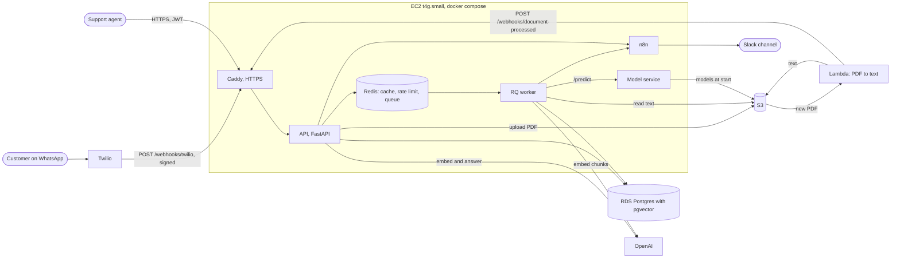

# Support AI

An AI customer support platform. Customers ask questions on WhatsApp, and a bot answers from the company's help docs and names the doc it used. Questions it can't answer become tickets. Machine learning models set each new ticket's priority and flag angry customers, and the team hears about urgent tickets in Slack.

It runs on AWS, deploys itself on every merge to `main`, and was also run on Kubernetes (EKS) with autoscaling. The [design doc](docs/design-doc.md) explains how it works, what breaks first as load grows, and why each choice was made.

## What it does

- **Answers on WhatsApp from the help docs.** A question is embedded, the closest chunks of the docs are found with pgvector, and `gpt-4.1-mini` answers only from them. If the docs don't cover it, the bot says so, and the message becomes a ticket instead of a made-up answer.
- **Learns new docs in seconds.** An agent uploads a PDF. A Lambda pulls out its text, and a background worker splits it into chunks and embeds them.
- **Triages tickets.** A model service predicts each new ticket's priority and the customer's mood. A high-priority ticket or a very negative customer posts to Slack through n8n.
- **Gives agents an API.** Agents log in with JWTs, then list, filter, and update tickets and read conversations. Admins manage agents. The endpoints are in the [API reference](docs/api.md).

## Architecture



The API answers within Twilio's 15-second limit, so anything slow (embedding a doc, triaging a ticket, alerting Slack) runs as a job on the worker. Only Postgres is essential: if OpenAI, Redis, the model service, or n8n is down, customers still get a reply and tickets are still saved. Secrets live in AWS Parameter Store, and AWS access comes from IAM roles, so no keys sit in the code, on the server, or in GitHub.

## Results

Every number here was measured, and [docs/results.md](docs/results.md) says how.

| What | Result |
| --- | --- |
| Ticket list query on 100,000 tickets | First page **11.07 ms → 0.02 ms** with an index on `(created_at, id)`, about **550x** faster. A deep page only got about 3x faster, which is why cursor pagination is noted as the next step. |
| Dashboard counts with a Redis cache | **0.7 to 1.0 ms** median on a hit, against 5.8 to 6.2 ms counting in Postgres: **6 to 8.5x** faster, and Postgres runs 2 count queries a minute however many agents are watching. |
| Ticket priority model | Macro F1 **0.709** on 3,268 test tickets, up from a 0.594 baseline, by tuning Logistic Regression on TF-IDF with cross-validation. It beat XGBoost by about 0.09. |
| Customer mood model | Macro F1 **0.743** on 2,856 test messages. At the alert threshold, **99.1%** of flagged messages really are negative. |
| Bot on 25 test questions | Retrieval found the answer for **24/24** answerable questions, and **25/25** replies were right and named the right doc, including "I don't know" for the one the docs don't answer. The test set is small, so it can't tell chunk sizes apart. |
| Load test on EKS | **182 requests a second** from 200 simulated agents, **34 ms** median and **130 ms** at the 95th percentile, **1 error in 87,244**. The autoscaler took the API from **2 to 6 pods** within about a minute. |
| Tests | **More than 750** pytest tests, run with the linter on every pull request. |

## Built with

Python 3.14 and uv, FastAPI, Pydantic v2, SQLAlchemy 2 and Alembic, PostgreSQL with pgvector, Redis and RQ, LangChain with OpenAI, scikit-learn and XGBoost, Twilio WhatsApp, n8n and Slack, Docker, GitHub Actions, AWS (EC2 on Graviton, RDS, S3, Lambda, ECR, Parameter Store, IAM), and Kubernetes (minikube, EKS, Helm).

## Docs

- [Design doc](docs/design-doc.md): requirements, scale estimates, architecture, data model, bottlenecks, and trade-offs.
- [API reference](docs/api.md): the endpoints, their rules, and its status codes. The running API also serves interactive docs at `/docs`.
- [Results](docs/results.md): every measured number, with how it was measured.
- [Stage summaries](docs/stages/): what each stage built, the decisions behind it, and how to demo it.
- [System design notes](docs/system-design/): topics like caching, rate limiting, queues, and retries, as they apply here.
- [System design practice](docs/system-design/practice/): six classic interview designs, and this platform redesigned for 10 million users.
- [Roadmap](docs/ROADMAP.md): the build plan, step by step.

## Run it locally

You need Python 3.14, [uv](https://docs.astral.sh/uv/), PostgreSQL 16 with pgvector 0.8.2, and Redis. On a Mac, install and start them with Homebrew, then create a user and a database for the app:

```bash
brew install postgresql@16
echo 'export PATH="/opt/homebrew/opt/postgresql@16/bin:$PATH"' >> ~/.zshrc   # then open a new terminal
brew services start postgresql@16        # runs in the background, and starts again at login
createuser --pwprompt --superuser support   # asks you for a password
createdb --owner support support
createdb --owner support support_test    # the tests' own database, which they empty
brew install redis
brew services start redis
```

`support` is a superuser because only a superuser can turn on pgvector, which loads C code into the database. The migrations do that, and the tests rerun them on an emptied database. The containers' Postgres user is a superuser too, and on RDS the master user has `rds_superuser`. Postgres listens only on the Mac's own address, so nothing else can reach that user. (Made `support` without `--superuser`? `psql -d postgres -c "ALTER ROLE support SUPERUSER"`.)

pgvector is built from its source, because Homebrew's `pgvector` builds only for Postgres 17 and 18. `PG_SYSROOT` points the build at the macOS SDK the Mac has, in case Homebrew built Postgres with a newer one. Run it again after `brew upgrade postgresql@16`, which replaces the folder it installs into:

```bash
git clone --depth 1 --branch v0.8.2 https://github.com/pgvector/pgvector.git /tmp/pgvector
make -C /tmp/pgvector install PG_CONFIG=/opt/homebrew/opt/postgresql@16/bin/pg_config \
  PG_SYSROOT="$(xcrun --show-sdk-path)"
rm -rf /tmp/pgvector
```

Copy `.env.example` to `.env`, and put that password in `DATABASE_URL` and `TEST_DATABASE_URL`. Set `JWT_SECRET_KEY` to the output of `openssl rand -hex 32`. It's empty in the example on purpose, so the app won't start with a key anyone can read on GitHub. The Redis URLs work as they are. Settings are read from `.env`, which git ignores, and a real environment variable with the same name wins over it.

```bash
cp .env.example .env
uv sync
uv run alembic upgrade head              # create the tables
uv run python -m scripts.create_agent --email you@example.com --name "Your Name" --admin   # asks for a password
uv run uvicorn app.main:app --reload
uv run python -m worker.main             # the background worker, in a second terminal
```

Then open http://127.0.0.1:8000/docs to try the API.

The worker runs the slow jobs the API puts on a queue in Redis, with [RQ](https://python-rq.org/). Each job runs in a forked copy of the worker, so one that crashes can't take the worker down, and a failed job is kept in Redis with its error. `uv run rq info` shows the queue, the workers, and how many jobs failed.

Uploading help docs also needs the AWS CLI, logged in with `aws configure` (see [infra/aws/README.md](infra/aws/README.md)). boto3 reads the keys from `~/.aws`, so they never go in `.env`. Without them, uploads get a 503 and everything else works.

Every schema change is an Alembic migration in `alembic/versions/`. After pulling new code, run `uv run alembic upgrade head` again. See [alembic/README](alembic/README) for the other migration commands.

Other commands:

```bash
uv run pytest                            # run the tests on support_test, never the app's database
uv run ruff check .                      # lint, as CI does
uv run python -m scripts.seed            # add 1,000 realistic fake tickets (--reset deletes every agent too)
uv run python -m scripts.weekly_report   # save a weekly report to reports/weekly_report.csv
uv run python -m scripts.explain_list    # time the list query with EXPLAIN ANALYZE (seed 100,000 first)
uv run python -m scripts.measure_cache   # time GET /stats with and without the cache (see the script)
```

## Run it with Docker

Docker Compose runs the API, its worker, Postgres, Redis, and n8n in containers, so Python, Postgres, and Redis don't need to be installed. You need [Docker Desktop](https://www.docker.com/products/docker-desktop/).

Copy `.env.example` to `.env` as above. Compose only needs two values filled in: `JWT_SECRET_KEY` (`openssl rand -hex 32`) and `POSTGRES_PASSWORD` (`openssl rand -hex 24`). It points the API at the containers' own Postgres, Redis, and n8n, whatever `.env` says.

```bash
docker compose up --build -d             # build the API image, then start everything in the background
docker compose exec api python -m scripts.create_agent --email you@example.com --name "Your Name" --admin
```

Then open http://localhost:8000/docs for the API, and http://localhost:5678 for n8n ([set up the workflow](infra/n8n/README.md)).

- **Settings reach the containers as environment variables.** `.env` is never copied into the image, because `.dockerignore` leaves it out, so the same image can run anywhere with different settings. `.env.example` lists every setting, with the secrets left empty.
- **Migrations run by themselves.** The `migrate` container runs `alembic upgrade head` and exits, and the API and the worker wait until it has finished. After pulling new code, `docker compose up --build -d` rebuilds the image and applies any new migrations.
- **Only the API and n8n are reachable from the Mac,** and only at `127.0.0.1`. Postgres and Redis have no published ports, so they can't clash with the ones from Homebrew. For a database shell: `docker compose exec postgres psql -U support`.
- **Data lives in volumes.** The `postgres-data`, `redis-data`, and `n8n-data` volumes survive `docker compose down`. `docker compose down -v` deletes them. Redis keeps the job queue, so it saves every write to its volume (append-only), and queued jobs survive a restart.
- **Ports 8000 and 5678 are also the ones `uvicorn` and `npx n8n` use,** so stop those first.
- **Uploads get a 503 in compose on the Mac,** because the container has no AWS credentials, and `~/.aws` isn't shared with it on purpose. On EC2, later in Stage 5, the instance's IAM role gives the container its own. That needs the instance's metadata hop limit set to 2: a container on compose's network is one hop further from the metadata service than the instance itself, and at the default of 1 it gets no credentials.
- **WhatsApp works the same way.** Run `ngrok http 8000` as before. The API trusts ngrok's forwarded headers only from the Docker network's gateway, `172.28.0.1`. That's where ngrok's connections arrive, and no client can choose that address. `docker-compose.yml` explains why that matters.

```bash
docker compose ps                        # what's running
docker compose logs -f api               # follow the API's log
docker compose down                      # stop and remove the containers, keeping the data
```

The image can also be built on its own: `docker build -f infra/api.Dockerfile -t support-ai-api .`

## CI

Every push, to any branch, runs [.github/workflows/ci.yml](.github/workflows/ci.yml) on GitHub Actions:

- **lint** runs `uv run ruff check .`.
- **test** runs `uv run pytest`, against Postgres 16 and Redis 8 started as service containers next to the job. Each run makes its own random `JWT_SECRET_KEY`.
- **image** runs once both pass. It builds the API's image and the model service's on an ARM runner, and checks that they don't run as root. On `main` it then pushes them to Amazon ECR as `support-ai-api` and `support-ai-model`, tagged `sha-<commit>` (which ECR never lets change) and `latest`, for EC2 to pull. CI logs in to AWS with a short-lived token from GitHub (OIDC), so no AWS keys are stored in GitHub. [infra/aws/README.md](infra/aws/README.md) explains the role it uses. No settings or secrets go into the image. They're given to a container when it runs.
- **deploy** runs on `main` after `image`. It tells the EC2 server, through SSM Run Command, to pull the new images, run the migrations, and restart, then checks that the live API answers over HTTPS. [docs/rollback.md](docs/rollback.md) shows how to go back to an earlier image.
- **deploy-eks** runs `helm upgrade` on the EKS cluster, but only while the repository variable `EKS_CLUSTER` is set. The cluster is deleted now, so it's skipped.

Both install with `uv sync --locked`, which fails if `uv.lock` is out of date, and use the same uv version as the Mac and the Dockerfile. To run the same checks before pushing: `uv run ruff check . && uv run pytest`.

### Changing main

`main` is protected, so every change goes through a pull request, and it can only merge once `lint`, `test`, and `image` pass on its latest commit. That applies to the repo's owner too, and nobody can force-push to `main` or delete it. The rules are kept in [infra/github/](infra/github/README.md), with the command that applies them.

```bash
git switch -c my-change                  # work on a branch
git push -u origin my-change             # CI runs on the branch
gh pr create --fill                      # open a pull request
gh pr checks --watch                     # wait for the three checks
gh pr merge --merge --delete-branch      # merge once they pass
```

If `main` moves on while a pull request is open, the branch has to be brought up to date first (`gh pr update-branch`), so the checks run again against the newest `main`. The merge to `main` is a push like any other, so CI runs again there, publishes the images, and deploys them.

## Project layout

- `app/`: the API. `main.py` creates the app, `routers/` has the endpoints (one file per area), `models.py` the database tables, `schemas.py` the request and response shapes, `database.py` the database connection, `cache.py` the Redis cache, `rate_limit.py` the rate limit, `storage.py` the S3 uploads, `queue.py` the job queue, and `config.py` the settings.
- `worker/`: the background worker, which runs the jobs on the queue (`main.py`): embedding help docs and triaging tickets.
- `ml/`: preparing the datasets, training and tuning the models (`train.py`, `tune.py`), and the model service that serves them (`service.py`).
- `lambda/`: the Lambda that pulls the text out of uploaded PDFs.
- `alembic/`: database migrations.
- `docker-compose.yml`: the whole stack in containers. It sits at the root so `docker compose` finds it, and the `.env` beside it, without flags.
- `infra/`: the Dockerfiles for the API and worker (`api.Dockerfile`) and the model service (`model.Dockerfile`), the [Kubernetes manifests and Helm chart](infra/k8s/README.md), the exported [n8n workflow](infra/n8n/README.md), the [rules that protect main](infra/github/README.md), and the [AWS setup](infra/aws/README.md).
- `.github/workflows/ci.yml`: the CI workflow.
- `scripts/`: the seed script, the weekly report, the agent script, and the scripts that measure the list query, the cache, the bot, and the load (`locustfile.py`).
- `tests/`: pytest tests.
- `docs/`: the [design doc](docs/design-doc.md), the [API reference](docs/api.md), the roadmap, stage summaries, [measured results](docs/results.md), [system design notes](docs/system-design/), and the sample help docs.
