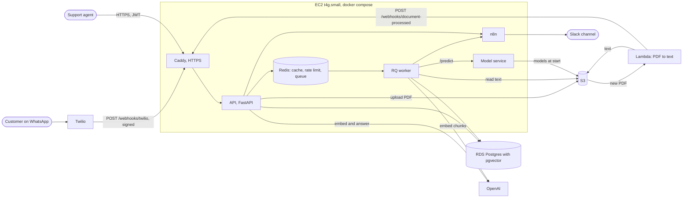
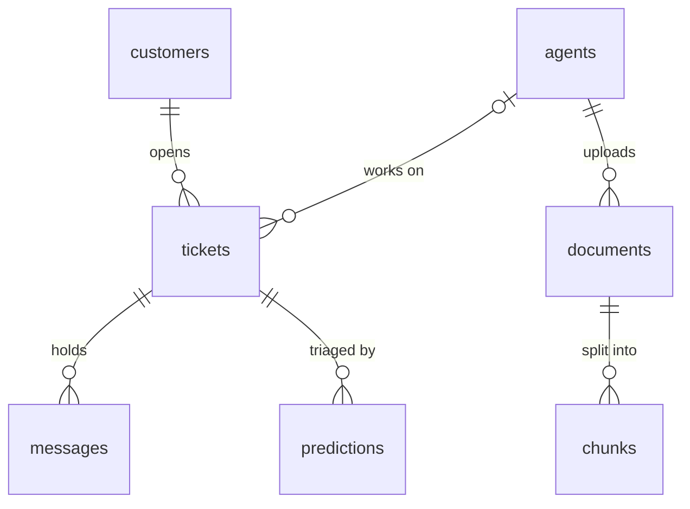

# Support AI: design doc

Customers ask questions on WhatsApp. A bot answers from the company's help docs and names the doc it used. Questions it can't answer become tickets for the support team. Models set each new ticket's priority and flag angry customers, and the team hears about the urgent ones in Slack.

This doc covers what the platform must do, how much load it's built for, how it works, what breaks first as load grows, and the trade-offs behind each choice. Numbers marked *measured* come from [`results.md`](results.md). The rest are estimates, with the arithmetic shown.

## Requirements

### What it does

1. **Answer customers on WhatsApp.** A customer's message gets a reply in the same chat. If the help docs answer it, the reply is the answer and the doc it came from. If not, the customer gets a ticket number and is told someone will follow up.
2. **Never make up an answer.** The bot answers only from the docs and says "I don't know" otherwise, which turns the message into a ticket.
3. **Keep one conversation per customer.** A customer is found by phone number. While they have an open ticket, their messages join it and skip the bot.
4. **Let agents work tickets.** Agents log in, list and filter tickets, read the conversation, and change status and priority. Admins also manage agents.
5. **Let agents add help docs.** An agent uploads a PDF, and within seconds the bot can answer from it.
6. **Triage new tickets.** A model predicts each new ticket's priority and the customer's mood. A high-priority ticket, or a very negative customer, alerts the team's Slack channel, and so does an agent marking a ticket urgent.
7. **Keep predictions for retraining.** Every prediction is saved, so it can later be compared with the priority the team settled on.

### How well it does it

- **Reply in time.** Twilio waits 15 seconds for the webhook's reply. Each OpenAI call is capped at 6 seconds, and the bot makes two (embed the question, then answer), so a reply is always sent in time, even if OpenAI is slow.
- **Stay up when a helper fails.** If OpenAI, Redis, the model service, or n8n is down, customers still get a reply and tickets are still saved. Only Postgres is essential.
- **Store each message once.** Twilio can deliver a message twice, and a customer can send several at the same moment. Neither may create a duplicate message or a second ticket.
- **Keep secrets out of code and servers' disks.** Passwords, API keys, and tokens live in AWS Parameter Store, and AWS access comes from IAM roles, not keys.
- **Cost little.** About $31 a month for AWS while it's a portfolio project.

### Out of scope, for now

- Agents replying to customers on WhatsApp from the API. Agents can read and update tickets, but sending their replies through Twilio isn't built.
- A web dashboard. Agents use the API (and its `/docs` page).
- More than one company (multi-tenancy), more than one region, and languages other than English. The priority model was trained on English tickets only.

## Scale estimates

The design target is a mid-sized online store: **100,000 customers, 5,000 WhatsApp messages a day, and 20 agents.**

| Quantity | Estimate | How |
| --- | --- | --- |
| Messages, average | 0.06 a second | 5,000 ÷ 86,400 |
| Messages, busy hours | 0.17 a second | half the day's messages in 4 hours: 2,500 ÷ 14,400 |
| Messages, bursts | about 2 a second | 10 times the busy-hour rate, such as during an outage |
| Bot answers | about 3,000 a day | assuming the bot answers 60% of messages |
| OpenAI cost | at most about $70 a month | under $0.001 a question (*measured*: 25 questions cost about $0.02, including embedding the docs), times 3,000 a day. The answer cache cuts repeats. |
| New tickets | about 1,000 a day | the other 40%, less messages that join a ticket already open |
| Stored messages | about 3,000 a day | customers' messages on tickets, plus agents' |
| Agent dashboard reads | about 4 a second | 20 agents each loading 2 things every 10 seconds |
| Database growth | about 1 GB a year | 1.1 million messages at about 0.5 KB, 365,000 tickets at about 150 bytes (*measured*: 100,000 tickets took 15 MB), and 730,000 predictions at about 200 bytes, plus indexes |
| Help doc chunks | about 4,000, 28 MB | 200 docs of 20 chunks, each 1,536 numbers × 4 bytes (6 KB) plus 1 KB of text |

What those mean:

- **The traffic is small.** The load test (*measured*) served 182 requests a second at a 34 ms median and 130 ms at the 95th percentile, on 6 API pods using about 1.1 vCPUs in all. That's about 160 requests a second per vCPU, so the target's 4 to 6 requests a second needs a small fraction of one.
- **The data is small.** The 20 GB database disk holds many years at this rate, and every table fits in memory.
- **The money is in OpenAI and Twilio, not servers.** At this volume, OpenAI could cost twice what AWS does. That's why answers are cached, and why the model service, which is free to run, triages tickets instead of an LLM.

## Architecture

The API and worker read their secrets from Parameter Store when they start. Everything runs in `us-east-2`.

### The parts

| Part | What it does | Why it's separate |
| --- | --- | --- |
| **API** (`app/`) | Every HTTP endpoint: the Twilio webhook, agents' ticket endpoints, uploads, `/ask`, login | The one place requests come in |
| **Worker** (`worker/`) | Background jobs from the Redis queue: embedding docs, triaging tickets | Jobs that call slow services or take seconds shouldn't hold a request open |
| **Model service** (`ml/service.py`) | Serves the priority and sentiment models over HTTP | The models need SciPy and scikit-learn (335 MB *measured*), which the API doesn't. They can be updated and scaled on their own. |
| **Redis** | Cache, rate limit counts, and the job queue | Fast, shared by every API copy, and nothing in it can't be rebuilt |
| **Postgres on RDS** | Customers, tickets, messages, agents, docs, chunks with their embeddings, predictions | The only part whose data matters. RDS handles its backups. |
| **Lambda** (`lambda/`) | Pulls the text out of each uploaded PDF | Runs only when a PDF arrives, so it costs nothing in between, and a bad PDF can't crash the API |
| **n8n** | Turns an alert into a Slack message | The team can change the message or channel without a deploy |
| **Caddy** | HTTPS with a free Let's Encrypt certificate | Simpler than a load balancer for one server |

### How a WhatsApp message flows

1. Twilio POSTs the message to `/webhooks/twilio`. The API checks Twilio's signature (an HMAC of the URL and fields, keyed with the account's token) and rejects anything unsigned with a 403.
2. **The bot goes first,** unless the customer already has an open ticket or sent no text. It looks for the cleaned-up question in the Redis cache. On a miss, it embeds the question, finds the 4 closest chunks in pgvector by cosine distance, and asks `gpt-4.1-mini`, at temperature 0, to answer only from them. The answer is cached for a day.
3. **If the bot answers,** the reply is the answer and its sources, and nothing is stored.
4. **If not,** the API locks the customer's row, checks the message's Twilio id isn't stored already, adds the message to their open ticket or opens one, and commits. A new ticket gets a confirmation reply and a triage job on the queue.
5. **The worker triages it** seconds later: it asks the model service for the priority and the mood, saves the priority and both predictions in one commit, then alerts n8n if the priority is high or the customer's negative score is at least 0.8.

### How a help doc becomes answers

1. An agent uploads a PDF to `POST /documents`. The API stores it in S3 under a random name and saves a row.
2. S3 starts the Lambda, which saves the PDF's text to S3 and calls `/webhooks/document-processed`.
3. The API queues an embedding job. The worker splits the text into chunks of about 1,000 characters with 200 of overlap, embeds them, and replaces the document's chunks in one transaction.
4. The docs version changes, so every cached answer is stale at once.

### Deploying it

Every pull request runs the linter and all the tests (755 today) in GitHub Actions. A merge to `main` builds ARM images, pushes them to ECR, and tells the server, through SSM Run Command, to pull them, run the migrations, and restart. CI reaches AWS through OIDC, so GitHub holds no AWS keys. The same images also ran on EKS with a Helm chart (Stage 8). That cluster is deleted now, because it cost about $0.20 an hour.

## Data model

| Table | Holds | Notable columns and indexes |
| --- | --- | --- |
| `customers` | Someone who contacted support | `phone` is unique (E.164), which also indexes it, since every WhatsApp message looks a customer up by it |
| `agents` | Support team members | `email` is unique. `password_hash` is Argon2. `is_active` turns an account off without breaking the tickets that point to it. `role` is agent or admin. |
| `tickets` | One support conversation | `status` (open, pending, closed) is indexed for the stats counts. `(created_at, id)` is indexed for the newest-first list. `priority` has no index, because Postgres never used one (*measured*: 0 times). |
| `messages` | Each message in a ticket | `twilio_sid` is unique, so a message Twilio delivers twice is stored once. `sender` is customer, agent, or bot. |
| `documents` | An uploaded help doc | `s3_key` is a random name, unique, so two files called `manual.pdf` can't overwrite each other |
| `chunks` | A piece of a doc and its embedding | `embedding` is a `vector(1536)`. `(document_id, position)` is unique, so a job that runs twice can't save two copies. |
| `predictions` | What a model said about a ticket | `model`, `version`, `label`, and every label's `scores`, kept for retraining and drift checks |

Why it's shaped this way:

- **Relational, in one Postgres.** The data is linked (a message belongs to a ticket, which belongs to a customer) and needs transactions: the row lock and the unique Twilio id are what stop duplicates. pgvector keeps the embeddings in the same database, so there's one thing to back up and pay for.
- **Statuses and priorities are Postgres enums,** so a bad value can't be stored, even by a script that skips the API.
- **Datetimes are UTC with a time zone,** so nothing depends on where a server is.
- **Migrations are additive where they can be,** because during a rolling deploy the old code still runs against the new schema.

## Bottlenecks and failure points

### What breaks first as load grows

In order, with the next step for each:

1. **The webhook waits on OpenAI.** FastAPI runs each WhatsApp request on one of 40 threads per process, and a bot answer holds a thread through two OpenAI calls. If OpenAI slows to its 6-second cap per call, one process handles about 40 ÷ 12 ≈ 3 messages a second before Twilio's requests start to queue. *Next step:* reply to Twilio at once with an empty response, queue the question, and have the worker send the answer through Twilio's messaging API. Then the webhook takes milliseconds, whatever OpenAI does.
2. **Database connections.** Each API process keeps up to 15 connections (SQLAlchemy's default pool of 5, plus 10 overflow), and so does the worker. RDS sets the limit from memory, which on a 1 GB `db.t4g.micro` is somewhere near 100 (`SHOW max_connections;` gives the exact number). At 6 API pods, the most the autoscaler allows, the pools could ask for about 105. *Next step:* a smaller pool per pod, or a connection pooler like RDS Proxy or PgBouncer, then a bigger instance.
3. **Deep pages.** The ticket list uses `OFFSET`, which reads and discards every skipped row: skipping 50,000 took 7.59 ms, against 0.02 ms for the first page (*measured*). *Next step:* cursor pagination on `(created_at, id)`, which the index already supports.
4. **Vector search with no index.** Each question scans every chunk. That's fine for thousands. Past roughly 100,000 chunks, an HNSW index on `embedding` keeps searches fast, at the cost of slightly approximate results and slower inserts.
5. **One worker process.** RQ runs one job at a time per worker, and a triage takes 0.66 to 1.6 seconds (*measured*), so one worker triages over 2,000 tickets an hour. The target needs about 1,000 a day. *Next step:* more worker processes. Jobs are already safe to run in parallel and twice.
6. **The per-IP rate limit.** It's keyed by address, so 20 agents behind one office network share 60 requests a minute. *Next step:* key it by agent for logged-in requests.

### What happens when a part fails

| Fails | Effect | Why |
| --- | --- | --- |
| OpenAI | Customers get a ticket instead of an answer. Doc embedding retries 3 times over 12 minutes, then waits in RQ's failed list. | The webhook catches OpenAI errors. A person is a better fallback than a late or wrong answer. |
| Redis | No cache, no rate limit, no new jobs. Requests still work, from Postgres. New tickets stay at medium priority. | The cache and rate limit give Redis 0.5 seconds, then skip it (*measured*: 2.7 seconds a call with redis-py's defaults). A ticket is saved even when its job can't be queued. |
| Model service | Triage tries 3 times with jittered backoff, then RQ tries again after 5 s, 30 s, and 2 minutes. The ticket stays at medium until then. | Nobody waits on triage, so retrying is cheap |
| n8n | The alert is logged and lost. The ticket and its priority are saved. | An alert never blocks saving. Retrying alerts is a gap. |
| Twilio delivers twice | The second copy finds the first by its Twilio id and gets the same reply | The unique `twilio_sid`, checked after the customer's row lock |
| The EC2 server | Everything except S3 and the Lambda is down until it's back | One server is a single point of failure, accepted for cost |
| RDS | Requests that touch the database fail until it's back | One zone. Multi-AZ would roughly double its cost. |

## Trade-offs

| Chose | Over | Because | Would change when |
| --- | --- | --- | --- |
| One API service, plus a model service | Many microservices | One team, one codebase. The model service is split off only because its dependencies and scaling differ. | Separate teams own separate parts |
| pgvector in Postgres | A vector database like Pinecone | Thousands of chunks, one database to run, and chunks can be joined to their documents | Millions of chunks, or search load that competes with the ticket queries |
| RAG | Fine-tuning a model on the docs | New docs work within seconds, answers can cite their source, and nothing is trained | Never, for facts. Fine-tuning suits tone and format. |
| "I don't know" and a ticket | A best guess | A wrong refund policy costs more than a short wait for a person | |
| Answering inside the webhook | Answering from a background job | Simpler: no outgoing Twilio calls, and the reply is in the same request. It fits within Twilio's 15 seconds. | Message bursts, or slow OpenAI (bottleneck 1) |
| RQ on Redis | Celery, or SQS | Redis was already there for the cache, and RQ is a few lines to use | Jobs must survive Redis losing data, or need strict ordering |
| Logistic Regression | XGBoost, or an LLM | Best macro F1 on priority (0.709 against 0.615, *measured*), 100 times faster to train, 1.1 to 2.4 MB on disk, and free to run | A model beats it on held-out tickets from this platform's own data |
| Alert at a 0.8 negative score | The model's usual 0.5 | 99% of flagged messages are really negative (*measured*). At 0.5, over half of all messages would alert, and the team would learn to ignore the channel. | The team says it's missing angry customers |
| Sliding-window log rate limit | A fixed per-minute counter | Can't be beaten by bursting either side of the minute | Memory per IP matters: it stores one entry per request |
| One EC2 server with docker compose | EKS, or ECS | About $31 a month against about $146 for the cluster. The load is far below what one server handles. | The load needs more than one server, or downtime during deploys matters |
| RDS | Postgres in a container | Backups, patching, and restores without running them | |
| Parameter Store | Secrets Manager | Free, and rotation isn't used | Secrets must rotate on a schedule |
| n8n for Slack | Calling Slack from the API | Message and channel changes need no deploy | |
| Lambda for PDF text | Doing it in the API | A large or bad PDF can't slow or crash the API, and it costs nothing while idle | |

## Security

- **Callers prove who they are.** Twilio's requests are signed. n8n checks a shared secret header. Agents log in with Argon2-hashed passwords and get a JWT. Admin-only endpoints check the role.
- **Input is bounded.** Pydantic validates every body, with lengths and `extra="forbid"`. Request bodies are capped at 10 MB plus a little, the largest PDF allowed. Path ids are capped at Postgres's largest integer.
- **The database is private.** RDS has no public address and lets in only the server's security group. The API connects with TLS and checks the certificate.
- **No long-lived AWS keys.** The server, the Lambda, and CI use IAM roles, each with only the actions it needs. The server allows only IMDSv2.
- **`main` is protected.** Changes go through pull requests whose checks must pass.

## Cost

| Item | A month |
| --- | ---: |
| EC2 `t4g.small`, its disk, and its IPv4 address | about $17.50 |
| RDS `db.t4g.micro` and 20 GB | about $14 |
| S3, ECR, Lambda, Parameter Store, CloudWatch | under $1 |
| OpenAI | cents now. At the design target, at most about $70. |
| Twilio | per message, by Twilio's and Meta's rates |
| EKS, while it existed | about $0.20 an hour, about $146 a month |
