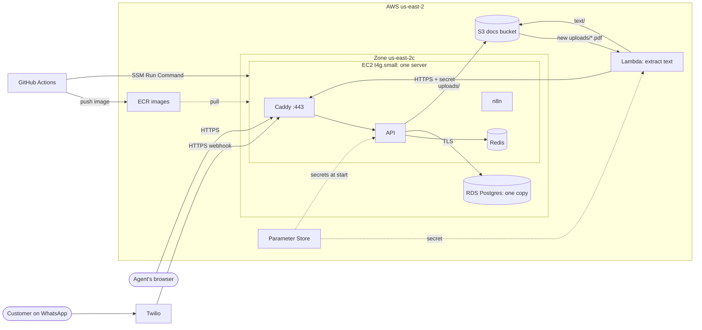

# The AWS setup and its single points of failure

Everything the project runs in production at the end of Stage 5, and what stops working if each piece fails.

## Single points of failure

| Piece | If it fails | What would remove it | Why it's kept |
| --- | --- | --- | --- |
| **The EC2 server** | Everything: the API, WhatsApp replies, Caddy, Redis, and n8n stop. Lambda's calls fail and are dropped after 3 tries. | Two or more servers in different zones behind a load balancer, Redis in ElastiCache, n8n elsewhere. Stage 8 moves the API to EKS. | Cost and simplicity: one $12 server. Its data lives in RDS and S3, so a new server can take over. |
| **Zone us-east-2c** | The server and the database both. | Multi-AZ RDS and servers in a second zone. | Both in one zone avoids cross-zone fees and latency, and with one copy of each, a second zone wouldn't help. |
| **RDS (single-AZ)** | Every request that reads or writes data. | Multi-AZ, a standby that takes over in a minute or two. | Doubles the database's cost. Backups restore to any moment of the last 7 days. |
| **Redis (a container)** | The cache and the rate limit. The API keeps working: both fail open. | ElastiCache, or Redis with a replica. | Losing it costs only speed and limits, never data. |
| **n8n (a container)** | Urgent-ticket Slack alerts are skipped and logged. | n8n on its own host, or the API posting to Slack directly. | Alerts are a convenience. The ticket is always saved. |
| **Caddy and its certificate** | HTTPS stops. Caddy renews 30 days early, so a renewal problem has weeks to be noticed. | A load balancer with an ACM certificate (Stage 8). | Free and automatic. |
| **Cloudflare DNS and the Elastic IP** | The name stops pointing at the server. | A second DNS provider. | Cloudflare's DNS is about as reliable as DNS gets. The Elastic IP survives restarts. |
| **Twilio** | WhatsApp messages don't arrive. | Another channel, such as email. | It's the channel itself. Twilio retries webhooks. |
| **Parameter Store** | A container that starts during an outage stops within a minute and Docker retries. Running containers keep their secrets. | Caching the secrets on disk, which would weaken the "no secrets on disk" rule. | Only read at start. |
| **The Lambda** | Uploads stay `uploaded` until a retry works. After 3 failed tries the event is dropped. | An on-failure destination (an SQS queue) to keep failed events. Stage 6 adds a dead-letter list for jobs. | Rare, visible in the logs, and an upload can be done again. |
| **ECR and GitHub Actions** | New deploys stop. What's running keeps running. | Nothing needed for uptime. | They're only on the path of a change, not of a request. |

The biggest single risk is the server: one machine runs every always-on piece. The path out of that is Stage 8's EKS setup, which also shows what had to move off the server first (Redis and n8n).
