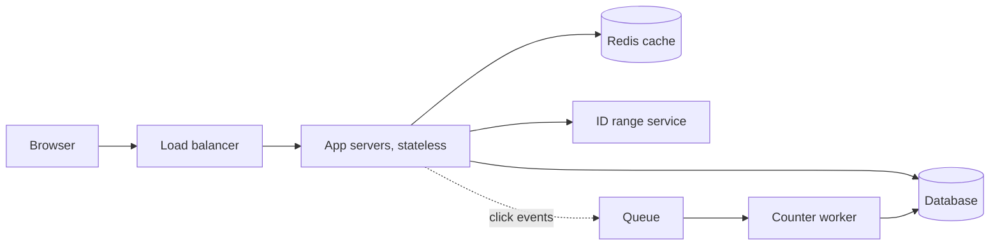

# Design a URL shortener

Like bit.ly: turn a long URL into a short one, and send anyone who opens the short one to the long one.

## Requirements

Functional:

1. Create a short link for a long URL, with an optional custom alias.
2. Redirect a short link to its long URL.
3. Links can expire.
4. Out of scope: accounts, editing links, and detailed analytics (only a click count).

Non-functional:

- Redirects are fast, under about 20 ms on the server, because every click waits on them.
- Redirects are highly available. A broken short link breaks every page that contains it.
- Two links never get the same code.
- Read-heavy: about 100 redirects for each link created.

## Estimates

| Quantity | Estimate | How |
| --- | --- | --- |
| New links | about 40 a second | 100 million a month ÷ 2.6 million seconds |
| Redirects | about 4,000 a second, 10,000 at peak | 100 times the writes |
| Links stored | 6 billion | 100 million a month × 12 × 5 years |
| Storage | about 3 TB | 6 billion × about 500 bytes |
| Code length | 7 characters | Base62 (a–z, A–Z, 0–9): 62⁷ is about 3.5 trillion codes, far more than 6 billion |
| Cache | about 5 GB | the hot 10 million links × 500 bytes, one Redis node |

## API

- `POST /urls` with `{long_url, alias?, expires_at?}` → `201 {code, short_url}`. `409` if the alias is taken.
- `GET /{code}` → `302` with `Location: <long_url>`, or `404` if it's unknown or expired.

301 or 302? A 301 (permanent) lets browsers cache the redirect, which saves load but means repeat clicks never reach the server, so they can't be counted. A 302 (temporary) reaches the server every time. I'd use 302, because counting clicks is a requirement.

## Data model

`urls`: `code` (primary key), `long_url`, `created_at`, `expires_at`, `click_count`.

Every read is "get one row by its code", a key-value lookup. That fits a key-value store such as DynamoDB, or Postgres sharded by `code`. At 3 TB and 40 writes a second, Postgres with a few shards, or one large instance and read replicas, also works. I'd start with Postgres, because it's simpler to run and query, and the access pattern makes sharding by `code` easy later.

## High-level design

**Create:** the app server takes the next ID from its range, encodes it in base62, saves the row, and returns the code.

**Redirect:** the app server looks for the code in Redis. On a miss, it reads the database and caches the answer. It returns the 302, and puts a click event on the queue so the redirect never waits on a write.

## Deep dives

**Generating codes.** Two options:

- *Hash the URL* (such as the first 7 characters of its SHA-256 in base62). The same URL always gets the same code, but two URLs can collide, so every create needs a check and a retry.
- *A counter, encoded in base62.* Never collides, so no check. One shared counter is a bottleneck and a single point of failure, so each app server takes a range of 1,000 IDs at a time from a small ID service (or a database sequence) and hands them out from memory. A crash only wastes the rest of its range.

I'd use counter ranges. Codes from a counter are guessable, so if that matters, scramble the ID with a reversible function before encoding it.

**Custom aliases** share the code space. Insert with a unique constraint, and return `409` if it fails, rather than checking first and racing another request.

**Caching.** Cache-aside with an LRU eviction policy, because a few links get most clicks. Also cache "not found" for a minute, so someone hammering unknown codes doesn't reach the database. That's the same pattern as this project's answer cache ([notes](../04-caching-and-rate-limiting.md)).

**Expiry.** Check `expires_at` on each read, so an expired link stops working at once, and delete expired rows in a nightly batch job.

**Abuse.** Rate limit link creation per IP or API key ([rate limiter design](02-rate-limiter.md)), and check new URLs against a malware list.

## Wrap-up

- **What breaks first:** a viral link sends a burst of reads at one key. The cache absorbs it. If one Redis node can't, put a CDN in front of redirects, or keep a small cache inside each app server.
- **If Redis fails:** reads fall through to the database and its replicas, which need enough headroom for that. Give Redis a short timeout, as this project does.
- **If the database fails:** cached links keep working. New links fail until a replica is promoted.
- **Next:** analytics (clicks by country and referrer) from the click events, without touching the redirect path.
