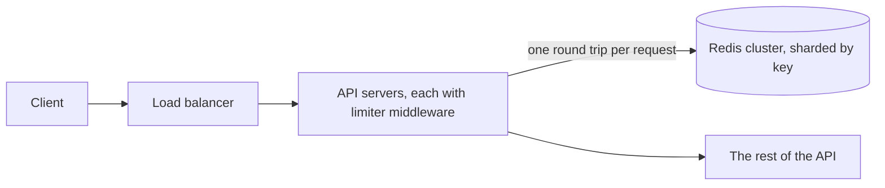

# Design a rate limiter

A service that every API server asks "may this client make another request?" before doing any work. This project has a small one (per IP, in Redis, [notes](../04-caching-and-rate-limiting.md)), so this design is its grown-up version.

## Requirements

Functional:

1. Limit requests per client: a user id, an API key, or an IP address when nobody is logged in.
2. Rules per endpoint, such as 5 login attempts a minute and 1,000 API calls an hour.
3. A refused request gets `429 Too Many Requests` with a `Retry-After` header.
4. Out of scope: billing by usage, and limits across regions (covered briefly in the wrap-up).

Non-functional:

- Adds under about 1 ms to each request, because every request pays it.
- Works across many API servers, so one client can't get more by reaching different servers.
- A limiter outage must not take the API down with it.

## Estimates

| Quantity | Estimate | How |
| --- | --- | --- |
| Checks | 100,000 a second at peak | one per API request |
| Active clients | 10 million | daily active users |
| Memory for counters | about 1 GB | 10 million keys × about 100 bytes, for algorithms that keep a counter or two per client |
| Memory for a request log | tens of GB | 10 million clients × up to 100 entries × about 50 bytes: too much |

The memory row decides the algorithm: keep counters, not a log of every request.

## API

Inside the API it's middleware, so the "API" is one call: `allow(client_key, rule) → (allowed, remaining, retry_after)`. Responses carry `X-RateLimit-Limit`, `X-RateLimit-Remaining`, and, when refused, `Retry-After`.

## Data model

Redis keys like `rl:{rule}:{client}`, holding a counter (or two) with an expiry. The rules live in a config file or a small table, and each API server keeps them in memory.

## High-level design

The middleware works out the client key (the user from the token, otherwise the IP), finds the rule for the endpoint, makes one atomic call to Redis, and either continues or returns 429.

## Deep dives

**The algorithm.** Five common ones:

| Algorithm | How | Good | Bad |
| --- | --- | --- | --- |
| Fixed window counter | Count per calendar minute | Simplest, one counter | A client can send the full limit at 12:00:59 and again at 12:01:00, twice the limit in two seconds |
| Sliding window log | Store each request's time and count those in the last minute | Exact | Memory grows with the limit. This project uses it, which is fine for 60 a minute per IP. |
| Sliding window counter | This window's count plus the previous window's, weighted by how much of it still overlaps | Close to exact, two counters | An estimate, not exact |
| Token bucket | Tokens refill at a steady rate, and each request spends one | Allows short bursts, two numbers per key | Two settings to tune |
| Leaky bucket | Requests join a queue drained at a steady rate | Smooth output | Bursts wait instead of being refused |

At this scale I'd use a token bucket, or a sliding window counter, because both fit in a few bytes per client. A token bucket lets a client send a burst, such as a page loading 10 things at once, and still holds its long-run rate.

**Race conditions.** If two servers read "4 of 5 used" at the same moment, both allow the request. Make the check and the update one atomic step: a Lua script in Redis, which runs without interruption.

**Failing open or closed.** If Redis is slow or down, either allow the request (open) or refuse it (closed). Open for most endpoints, because an outage of the limiter shouldn't become an outage of the API. This project fails open after a 0.5-second timeout. Closed for login, where the limit is the defense against password guessing.

**The client key.** Many users behind one office or mobile network share an IP. Use the user or API key whenever the request is authenticated. This project's design doc lists this as bottleneck 6: 20 agents in one office share 60 requests a minute.

## Wrap-up

- **What breaks first:** one Redis node at about 100,000 operations a second. Shard by client key across a Redis cluster, so each client's counters live on one node.
- **If a Redis shard fails:** clients on that shard are unlimited (failing open) until its replica takes over.
- **Many regions:** a global limit would need a round trip between regions on every request. Instead, give each region its own limit (such as a third of the total in each of three regions), and accept that it's approximate.
- **Next:** a dashboard of refused requests by rule, to catch rules that are too tight.
