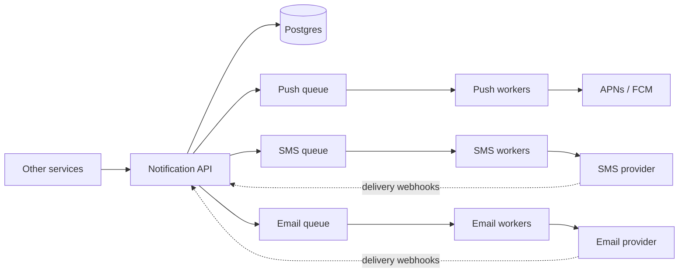

# Design a notification system

One service that the rest of a company's services call to reach users by mobile push, SMS, and email. This project's Slack alert, sent from the worker through n8n, is a one-channel version of it.

## Requirements

Functional:

1. Other services send a notification for a user, by template and data.
2. It goes out by push (Apple's APNs and Google's FCM), SMS (such as Twilio), or email (such as Amazon SES).
3. Users choose which kinds they get on which channel, and can opt out.
4. Notifications can be scheduled for later.
5. Delivery status can be looked up.

Non-functional:

- No notification is lost, and none is sent twice.
- Urgent ones, such as a login code, arrive within seconds, even during a marketing blast.
- A slow or failing provider doesn't hold up the others.

## Estimates

| Quantity | Estimate | How |
| --- | --- | --- |
| Notifications | 16 million a day | 10 million push, 5 million email, 1 million SMS |
| Average rate | about 185 a second | 16 million ÷ 86,400 |
| Peak | about 2,000 a second | a marketing blast, 10 times the average |
| Log storage | about 8 GB a day, 720 GB for 90 days | 16 million × about 500 bytes |

## API

- `POST /notifications` with `{user_id, template, data, category, idempotency_key, send_at?}` → `202 Accepted {id}`. 202, because sending happens later.
- `GET /notifications/{id}` → its status per channel: queued, sent, delivered, or failed.
- `GET` and `PUT /users/{id}/preferences`.

## Data model

| Table | Main columns |
| --- | --- |
| `contacts` | user id, device tokens, phone, email |
| `preferences` | user id, category, channel, on or off |
| `templates` | name, channel, body with placeholders |
| `notifications` | id, user id, category, `idempotency_key` (unique), status, created and sent times |
| `deliveries` | notification id, channel, provider, attempt, status, provider's message id |

Postgres for preferences and templates, which are small and relational. The notification log is write-heavy and read by id, and could move to a key-value store when it outgrows Postgres.

## High-level design

The API checks the idempotency key, loads the user's preferences and contacts, renders the template for each allowed channel, saves the notification, and queues one message per channel. Workers send, record each attempt, and retry failures. Providers report delivery back through webhooks.

## Deep dives

**A queue per channel.** If email is slow, push keeps flowing. Each channel's workers scale on their own queue's depth. Urgent categories get their own high-priority queue too, so a login code doesn't wait behind a million marketing emails.

**Retries.** Retry with exponential backoff and jitter, so a recovering provider isn't hit by every retry at once. After the last attempt, the message goes to a dead-letter queue for a person to look at. For SMS, fail over to a second provider. These are the same ideas as this project's model-service retries ([notes](../17-timeouts-retries-circuit-breakers.md)).

**Sending once.** Queues deliver at least once, so a worker can get a message twice. The unique `idempotency_key` stops a caller's retry from creating a second notification, and a worker checks the delivery's status before sending, so a redelivered message is skipped. That's the same job the unique `twilio_sid` does in this project's webhook. Exactly once can't be promised end to end, because a provider can time out after it sent the message, but these checks make duplicates rare.

**Not losing a notification.** If the API saves the row and then crashes before queueing, the notification is lost. The fix is an *outbox*: save the notification and an outbox row in one transaction, and have a relay move outbox rows onto the queue. This is the gap in this project's alerts: if n8n is down, the alert is logged and lost.

**Limits per user.** At most a few marketing messages a day per user, and none in their quiet hours. Login codes and security alerts skip these limits.

**Scheduled and bulk sends.** A scheduler polls for notifications whose `send_at` has passed. A blast to millions of users is split into batches of a few thousand, so it never floods the queues.

## Wrap-up

- **What breaks first:** the providers' own rate limits during a blast. Workers read each provider's limit and slow down to it.
- **If a provider fails:** that channel's queue grows and drains when the provider recovers. SMS fails over to the second provider.
- **If the queue fails:** the outbox keeps every notification until the queue is back.
- **Next:** open and click tracking for email, and a per-category dashboard of delivery rates.
