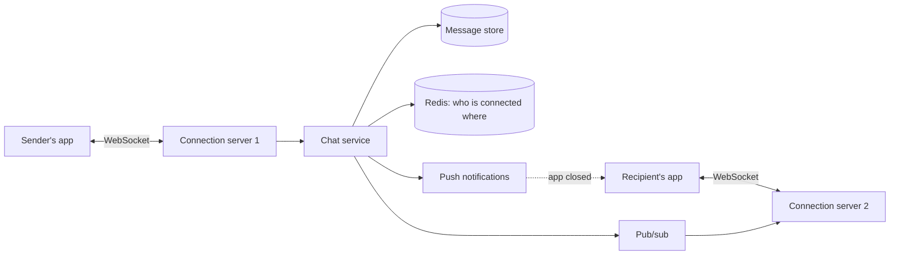

# Design a chat app

Like WhatsApp, which this project relies on: Twilio and Meta do all of this, and the project only sees one webhook per message.

## Requirements

Functional:

1. One-to-one chats and group chats of up to 200 people.
2. Messages arrive in real time while the app is open, and as a push notification when it isn't.
3. "Delivered" and "read" receipts, and whether a contact is online.
4. History is kept and syncs across a user's devices.
5. Out of scope: voice and video calls, and end-to-end encryption, beyond a mention.

Non-functional:

- A message reaches an online recipient in under about 200 ms.
- No message is lost, and messages in a chat show in the same order for everyone.
- Highly available. Short delays are acceptable, losing messages isn't.

## Estimates

| Quantity | Estimate | How |
| --- | --- | --- |
| Messages | 2 billion a day | 50 million daily users × 40 each |
| Message rate | about 23,000 a second, 60,000 at peak | 2 billion ÷ 86,400, then about 2.5 times |
| Storage | about 400 GB a day, about 150 TB a year | 2 billion × about 200 bytes, before copies |
| Open connections | about 10 million | a fifth of daily users online at once |
| Connection servers | about 100, plus spare | about 100,000 open connections each |

## API

- A **WebSocket** for live traffic, because the server must push messages to the client. Polling would mean millions of empty requests a second.
  - Client sends `{client_msg_id, chat_id, text}`. Server acks `{client_msg_id, msg_id, sent_at}`.
  - Server pushes `{msg_id, chat_id, sender_id, text, sent_at}`, and receipts `{chat_id, user_id, read_up_to}`.
- **REST** for everything else: `GET /chats/{id}/messages?before={msg_id}&limit=50` for history, `POST /chats` to create a group, and members' endpoints.

## Data model

| Data | Store | Key |
| --- | --- | --- |
| Messages | Cassandra or DynamoDB: write-heavy, read by chat in time order | partition `chat_id`, sort `msg_id` |
| Chats and members | Postgres | `chat_members(chat_id, user_id)`, indexed both ways |
| Each device's read position | the same store as messages | `(user_id, chat_id) → last_read_msg_id` |
| Which server holds each user's connection | Redis | `conn:{user_id} → server`, with a short expiry |

`msg_id` is sortable by time, like a Snowflake ID (a timestamp, a machine number, and a counter), so sorting by it is sorting by time.

## High-level design

1. The sender's connection server passes the message to the chat service.
2. The chat service gives it a `msg_id`, saves it, and only then acks the sender. Saving first means an acked message is never lost.
3. It looks up each member's connection server in Redis, and publishes the message to those servers, which push it down their sockets.
4. Members with no connection get a push notification. When the app opens, it fetches everything after its last `msg_id`.

## Deep dives

**Duplicates on resend.** On a bad network the app resends until it gets an ack, so the server may see a message twice. The `client_msg_id` makes the save idempotent: a second copy is found and acked again, not stored again. This project does the same with Twilio's message id.

**Ordering.** Order is only promised within a chat, which keeps it cheap: one chat's messages are sorted by `msg_id`. If two people send at the same millisecond, the order the server assigned is the order everyone sees.

**Group fan-out.** For a group of 200, one message becomes up to 200 deliveries, which is fine. For channels with millions of followers, fan-out on send is too much, so their clients fetch new messages instead, the same push-or-pull choice as in the [news feed](05-news-feed.md).

**Online status.** The app sends a heartbeat every 30 seconds, which refreshes a Redis key with a 60-second expiry, so a phone that drops off the network shows as offline within a minute. Status changes go only to contacts who are online and have that chat open, otherwise each change would fan out to every contact.

**Connection servers.** They hold state (open sockets), unlike the rest. A deploy drains them slowly, and clients reconnect to another server and catch up from their last `msg_id`.

## Wrap-up

- **What breaks first:** the number of open connections. Add connection servers. They scale on their own, apart from the chat service.
- **If a connection server dies:** its clients reconnect elsewhere and fetch what they missed. Nothing is lost, because every message was saved before being sent.
- **If the message store is slow:** sends slow down. Writes are spread by `chat_id`, so one busy chat can't slow the rest.
- **Next:** end-to-end encryption, where the server stores only ciphertext and keys live on devices.
