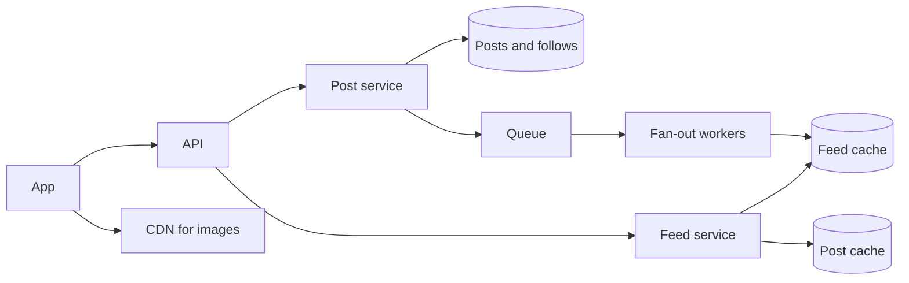

# Design a news feed

Like the home timeline on X or Instagram: the newest posts from everyone a user follows.

## Requirements

Functional:

1. Users publish posts with text and images.
2. Users follow other users.
3. The home feed shows posts from followed users, newest first, one page at a time.
4. Out of scope: ranking by interest (covered in a deep dive), comments, and ads.

Non-functional:

- The feed loads in under about 200 ms, because users open it many times a day.
- A new post may take a few seconds to show up in followers' feeds. Eventual consistency is fine.
- Read-heavy: about 20 feed loads for each post.

## Estimates

| Quantity | Estimate | How |
| --- | --- | --- |
| Feed loads | about 35,000 a second, 100,000 at peak | 300 million daily users × 10 a day ÷ 86,400 |
| New posts | about 1,700 a second | 300 million × 0.5 a day ÷ 86,400 |
| Feed inserts, if each post is copied to followers | about 350,000 a second | 1,700 × 200 followers on average |
| Post storage | about 150 GB a day | 150 million posts × about 1 KB. Images go to object storage. |
| Feed cache | about 1.2 TB, across a Redis cluster | 300 million users × 500 post ids × 8 bytes |

The third row is the key number: copying every post to every follower costs about 200 writes per post.

## API

- `POST /posts` with `{text, image_ids}` → `201 {post_id}`.
- `GET /feed?cursor={cursor}&limit=20` → `{posts, next_cursor}`.
- `POST /users/{id}/follow` and `DELETE /users/{id}/follow`.

## Data model

| Table | Main columns |
| --- | --- |
| `users` | id, name, follower count |
| `follows` | `follower_id`, `followee_id`, indexed both ways: "whom do I follow" and "who follows me" |
| `posts` | id (sortable by time), author id, created at, text, image keys |
| Feed cache, in Redis | a sorted set per user: post ids, scored by time, trimmed to the newest 500 |

## High-level design

**Publish:** the post is saved, then a fan-out job adds its id to each follower's feed in Redis.

**Read:** the feed service reads the next 20 ids from the user's sorted set, then fetches those posts from the post cache.

## Deep dives

**Fan-out on write, or on read?**

- *On write (push):* copy each post id into every follower's feed. Reads are one Redis call. But a celebrity with 100 million followers turns one post into 100 million writes.
- *On read (pull):* on each feed load, fetch the latest posts from everyone the user follows and merge them. Writes are free, reads are slow when someone follows thousands.
- *Both:* push for ordinary users. For the few with millions of followers, don't push. Instead, at read time, fetch their recent posts and merge them into the cached feed. Also skip pushing to users who haven't opened the app in 30 days, and build their feed when they come back.

I'd use both, with a follower count of about 10,000 as the line.

**Pagination by cursor, not offset.** New posts keep arriving at the top, so `OFFSET 20` would show a post twice when one is added between pages. And `OFFSET` gets slower the deeper it goes. This project measured it: 0.02 ms for the first page, 7.59 ms after skipping 50,000 rows. The cursor is the last post id seen, and the next page is "ids older than that".

**Images.** The app uploads straight to object storage with a presigned URL, so image bytes never pass through the API, and a CDN serves them.

**Ranking.** To rank by interest instead of time: take a few hundred candidate posts (the cached feed), score each with a model on features like the author, how much the user interacts with them, and the post's age, then sort. Scoring is its own service, as this project's model service is.

## Wrap-up

- **What breaks first:** fan-out falls behind when popular users post. The queue absorbs it, at the cost of a few seconds' delay, and more workers drain it.
- **If the feed cache fails:** feeds are rebuilt by fan-out on read, which is slower but correct. Only a cache lives there, so nothing is lost.
- **Deleted posts and blocked users:** filtered out when posts are fetched, so the cache needn't be cleaned at once.
- **Next:** ranking, and showing a "new posts" banner instead of moving the feed while someone reads.
