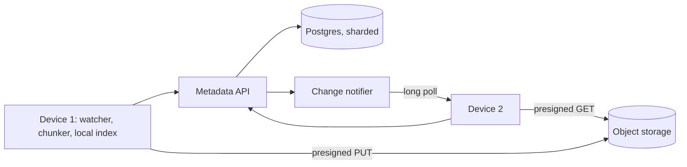

# Design Dropbox-like file storage

Files kept in the cloud and synced across a user's devices, with sharing and old versions.

## Requirements

Functional:

1. Upload and download files of up to 50 GB.
2. A change on one device shows up on the user's other devices.
3. Share a file or folder with other users.
4. Keep old versions for 30 days, and restore one.

Non-functional:

- Never lose a file. This is the top priority.
- Sync quickly, and save bandwidth: changing one line of a big file shouldn't upload all of it again.
- File metadata (names, folders, versions) is strongly consistent. Two devices never disagree about which version is current.

## Estimates

| Quantity | Estimate | How |
| --- | --- | --- |
| File changes | about 230 a second, 1,000 at peak | 10 million daily users × 2 a day ÷ 86,400 |
| File data | about 20 PB | 10 million users × 2 GB, before removing duplicates |
| Metadata | about 5 TB | 10 billion files (1,000 per user) × about 500 bytes |
| Upload bandwidth | about 2 GB a second | 230 changes × 10 MB on average. Too much to send through the app servers. |

The last row decides one thing early: file bytes go straight to object storage, never through the API.

## API

- `POST /uploads` with `{path, size, chunk_hashes}` → which chunks the server is missing, and a presigned URL to upload each.
- `PUT <presigned URL>`: the app uploads each missing chunk straight to object storage.
- `POST /files/commit` with `{path, base_version, chunk_hashes}` → `{file_id, version}`, or `409` if someone else changed the file first.
- `GET /files/{id}?version={n}` → the chunk list and a presigned URL for each.
- `GET /changes?cursor={cursor}` → changes since the cursor. A long poll: it waits up to a minute for a change.
- `POST /shares` with `{path, user_id, permission}`.

## Data model

| Table | Main columns |
| --- | --- |
| `files` | id, owner (or shared folder) id, path, current version, deleted |
| `file_versions` | file id, version, size, created at, created by device |
| `version_chunks` | file id, version, position, chunk hash |
| `chunks` | hash (primary key), size, storage key, reference count |
| `shares` | folder id, user id, permission |
| `changes` | folder id, sequence number, file id, version: the feed devices sync from |

Metadata in Postgres, for transactions, sharded by owner or shared folder, so one user's files stay on one shard. Chunks in S3, which is built for 99.999999999% durability.

## High-level design

1. Device 1 sees a file change, splits it into 4 MB chunks, and hashes each.
2. It asks the API which chunks are new, uploads only those straight to S3, then commits the new version.
3. The commit adds a row to `changes`, and the notifier wakes Device 2's long poll.
4. Device 2 fetches the new chunk list, downloads only the chunks it lacks, and rebuilds the file.

## Deep dives

**Chunking.** Splitting into 4 MB chunks gives three things. Only changed chunks are uploaded. A failed upload resumes from the last chunk, rather than starting a 50 GB file over. And identical chunks, even across users, are stored once, by hash. Removing duplicates across users can reveal that someone else has the same file, so a privacy-minded design removes them only within one user's files.

**Order of writes.** Upload the chunks first and commit the metadata last, in one transaction. Then a file version never points at a chunk that isn't there. A crash in between leaves orphan chunks, which a cleanup job deletes when nothing has referenced them for a day.

**Conflicts.** The commit sends `base_version`, the version the device started from. If the current version is newer, someone else got there first, so the API returns `409`, and the device saves its copy as "file (conflicted copy)". This is optimistic locking: no locks are held while someone edits.

**Presigned URLs.** The app server signs a URL that lets the device upload or download one object for a few minutes. Bytes go straight between the device and S3, so app servers handle only small metadata requests. This project uploads help-doc PDFs through the API instead, which is fine at 10 MB and a few a day. At this scale it wouldn't be.

**Old versions and cost.** Chunks are reference-counted, so deleting an old version frees only chunks no other version uses. Versions older than 30 days are deleted, and chunks untouched for months move to a cheaper S3 storage class.

## Wrap-up

- **What breaks first:** metadata for a huge shared folder, where thousands of users read the same shard. Cache its change feed, and split very large shared folders onto their own shard.
- **If the notifier fails:** devices fall back to polling `/changes` every minute. Sync is slower, but nothing is lost.
- **If a metadata shard fails:** its users can't sync until its replica takes over. Files already on their devices keep working.
- **Next:** sync on the local network between a user's own devices, and previews for documents and photos.
