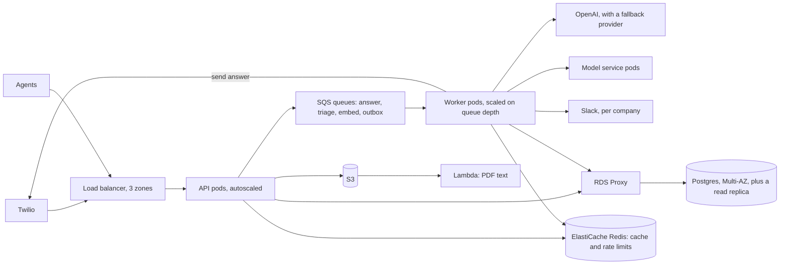

# Support AI at 10 million users

The [design doc](../../design-doc.md) builds for one mid-sized store: 100,000 customers, 5,000 messages a day, and 20 agents. This redesigns the platform for 10 million customers, 100 times that, and compares the result with what's built.

## Requirements

What changes with the scale:

1. **Many companies, not one.** A single store rarely has 10 million customers who message support. A support product with 10 million end customers is one sold to many companies. Say 2,000 companies, each with its own help docs, agents, WhatsApp number, and Slack channel. Each company must see only its own data.
2. **Higher availability.** Paying companies expect 99.9% at least: under 45 minutes down a month. Today one EC2 server and one RDS zone are both single points of failure, accepted for cost.
3. **Spend limits.** OpenAI becomes the biggest bill, so each company needs a usage cap.

The features stay the same: answer from the docs or open a ticket, triage, alert, and agents working tickets.

## Estimates

The design doc's numbers, times 100:

| Quantity | Today's target | At 10 million | How |
| --- | --- | --- | --- |
| Messages | 5,000 a day | 500,000 a day | 100 × |
| Messages, busy hours | 0.17 a second | 17 a second | half the day in 4 hours |
| Messages, bursts | about 2 a second | about 170 a second | 10 times the busy rate |
| Bot answers | about 3,000 a day | about 300,000 a day | 60% of messages |
| OpenAI cost | at most about $70 a month | about $7,000 a month, before caching | 300,000 × about $0.0008 (*measured*: 25 questions for about $0.02) × 30 |
| New tickets | about 1,000 a day | about 100,000 a day | 100 × |
| Agents | 20 | about 2,000 | 100 × |
| Agent dashboard reads | about 4 a second | about 400 a second | 2,000 × 2 every 10 seconds |
| Database growth | about 1 GB a year | about 100 GB a year | 100 × |
| Help doc chunks | about 4,000, 28 MB | about 8 million, 56 GB | 2,000 companies × 4,000 chunks × 7 KB |

What those mean:

- **The database writes are still small.** 300,000 messages, 100,000 tickets, and 200,000 predictions a day is about 7 writes a second on average. One Postgres primary handles that easily. No sharding is needed.
- **The API is still small.** About 420 requests a second at busy hours. At the load test's 160 requests a second per vCPU, that's about 3 vCPUs, so 6 pods across 3 zones leaves room for bursts.
- **The hard parts are elsewhere:** waiting on OpenAI, keeping companies apart, vector search over 8 million chunks, and the OpenAI bill.

## API

The same endpoints, with two changes:

- **Every request belongs to a company.** An agent's token carries `company_id`, and the Twilio webhook finds the company from the WhatsApp number the customer wrote to (Twilio's `To` field).
- **The webhook replies at once,** with an empty TwiML response, and the answer is sent afterward through Twilio's Messages API (deep dive 1).

## Data model

The same seven tables (customers, agents, tickets, messages, documents, chunks, predictions), plus:

- **A `companies` table,** with each company's WhatsApp number, Slack webhook, monthly OpenAI cap, and alert threshold.
- **`company_id` on every table,** first in every index, such as `(company_id, created_at, id)` for the ticket list. Uniques become per company, so a customer's phone number is unique within a company, not across all of them.
- **Postgres row-level security,** with a policy that each row's `company_id` matches the request's. The API sets the company on each transaction (`SET LOCAL app.company_id`), so a query that forgets its filter returns nothing rather than another company's tickets.
- **`messages` partitioned by month,** so old months can be moved to cheaper storage or dropped under a retention policy without a slow `DELETE`.
- **An `outbox` table** for alerts and outgoing replies (deep dive 4).

## High-level design

A WhatsApp message now:

1. The API checks Twilio's signature, finds the company by the `To` number, and stores the message, as today (row lock, unique `twilio_sid`).
2. It queues an "answer" job and returns an empty reply to Twilio within milliseconds.
3. A worker runs RAG over that company's chunks only. If it can answer, it sends the reply through Twilio's Messages API. If not, it opens a ticket and sends the ticket number.
4. Triage and alerts run as today, from their own queues.

## Deep dives

**1. Answering outside the webhook.** This is bottleneck 1 in the design doc. Today a bot answer holds a request thread through two OpenAI calls of up to 6 seconds each. At 170 messages a second during a burst, with OpenAI slow, that's 170 × 12 ≈ 2,000 threads waiting, about 50 processes' worth. With a queue, the webhook returns at once, and workers take answers at whatever rate OpenAI allows. The cost: outgoing Twilio calls to handle and retry, and the reply is no longer in the same request.

**2. Keeping companies apart.** Three choices:

| Choice | Good | Bad |
| --- | --- | --- |
| A database per company | Strongest separation, easy per-company backups | 2,000 databases to migrate and connect to |
| A schema per company | Good separation | Migrations run 2,000 times, and Postgres slows with tens of thousands of tables |
| Shared tables with `company_id` and row-level security | One schema, one migration, easy cross-company reporting | One bug could leak data, which row-level security guards against |

I'd share tables with row-level security, and offer a separate database only to a large company that pays for it. Caches and rate limits get the company in their keys too, and the answer cache's docs version becomes per company, so one company's upload doesn't clear everyone's answers.

**3. Vector search over 8 million chunks.** Scanning every chunk on each question stops being fine at about 100,000 chunks (bottleneck 4). Add an HNSW index on `embedding`, and filter by company inside the search. A filtered approximate search can come back with fewer than 4 results, which pgvector's iterative index scans (0.8 and later) fix by searching further. Very large companies can get a partition of their own. Shorter embeddings help too: `text-embedding-3-small` can return 512 numbers instead of 1,536, a third of the memory, for slightly less accuracy, which I'd measure on the retrieval test set before switching. A separate vector database only makes sense when search load starts slowing the ticket queries.

**4. Not losing alerts or replies.** Today, if n8n is down, the alert is logged and lost. At this scale, write an outbox row in the same transaction as the ticket, and have a worker send it to Slack, with retries and a dead-letter queue, the pattern in the [notification system design](03-notification-system.md). Each company connects its own Slack, so a per-company Slack app replaces the one n8n workflow.

**5. A durable queue.** RQ keeps jobs in Redis, and a Redis restart can lose them. With paying companies, I'd move the queues to SQS: managed, durable, with dead-letter queues built in, and workers scaled on queue depth (KEDA does this on Kubernetes). Redis stays for the cache and rate limits, where losing data only costs a little speed.

**6. The OpenAI bill.** About $7,000 a month before caching, against roughly $1,000 to $2,000 for AWS. Ways to cut it, in order: the exact-match cache already removes repeats; a per-company monthly cap stops one company running up the bill; a cheaper model for short, common questions; and OpenAI's discount for repeated prompt prefixes, by keeping the instructions at the start of the prompt. A second provider, behind the same 6-second timeout, keeps answers coming when OpenAI is down. Today, an outage turns every question into a ticket.

**7. Database connections.** Bottleneck 2: each pod's pool asks for up to 15 connections, and a small RDS instance allows about 100. With autoscaling to dozens of pods, put RDS Proxy (or PgBouncer) between the pods and Postgres, so thousands of client connections share a few hundred real ones. Move the agent dashboard's list and stats reads to a read replica, and use cursor pagination (bottleneck 3).

## Wrap-up

How it compares with what's built:

| Part | Built | At 10 million | Why |
| --- | --- | --- | --- |
| Servers | One EC2 server with docker compose | EKS across 3 zones, with autoscaling | Availability. Stage 8 already ran it on EKS and scaled 2 to 6 pods. |
| Bot answers | Inside the webhook | A queued job, sent through Twilio's API | Bursts and slow OpenAI |
| Tenancy | One company | `company_id` and row-level security | Many companies on one database |
| Postgres | `db.t4g.micro`, one zone | Multi-AZ, a bigger instance, RDS Proxy, a read replica | Availability and connections |
| Vector search | Full scan | HNSW, filtered by company | 8 million chunks |
| Queue | RQ on Redis | SQS, a queue per job type | Durability |
| Alerts | n8n, lost if it's down | Outbox, retries, a Slack app per company | No lost alerts |
| Rate limit | Per IP | Per agent and per company | Offices share IPs |
| OpenAI | One provider, no cap | Caps, a cheaper model for easy questions, a fallback provider | Cost and availability |
| Observability | Logs | Logs, metrics, and traces, with alerts on reply time and error rate | Finding problems before companies do |

What stays: one API service plus the model service, Postgres with pgvector, RAG with "I don't know" turning into a ticket, the priority and sentiment models, IAM roles and Parameter Store, the Helm chart, and CI with OIDC. The design held up. The changes are about availability, tenancy, and cost, not a rewrite.

What breaks next, past 10 million: if one company becomes very large, its search and writes deserve their own database. If the data grows past a few TB, `messages` would be the first table to shard, by company.
